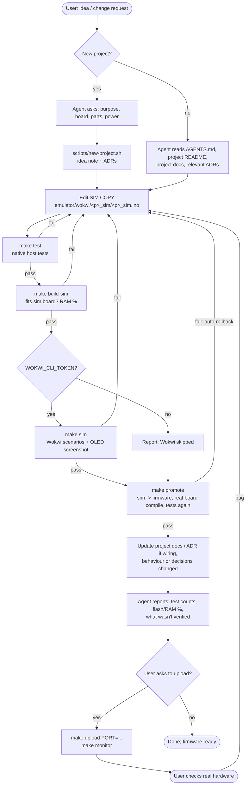
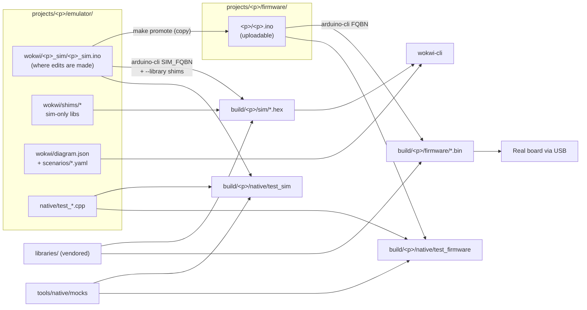

# Development workflow (agentic)

How an idea becomes code on a board, and who does what at each step.

## End to end

## What each tier can and cannot prove

| | Native (`make test`) | Wokwi (`make sim`) | Real board |
|---|---|---|---|
| Runs | `.ino` + mocks on the Mac (clang++) | sim `.ino` on an emulated AVR/ESP32/Pico | firmware on the target |
| Cost | free, ~2 s | 50 free min / 30 days | your time |
| Thresholds, state machines, timing math | ✅ | ✅ | ✅ |
| Sensor-failure paths (NaN, unplugged) | ✅ easy | ⚠️ partial | ❌ hard to stage |
| Real library code, I2C/OneWire traffic | ❌ mocked | ✅ | ✅ |
| Pixels on the OLED | ❌ text only | ✅ screenshot | ✅ |
| RAM/stack limits | ❌ | ✅ (of the sim board) | ✅ |
| Board-specific (R4 WiFi radio, LED matrix, RA4M1 timing) | ❌ | ❌ | ✅ |

## Code flow between folders

## Rules this enforces

- Firmware is only ever overwritten after the sim copy passes its tests, and only kept if the firmware then
  compiles for the real board and passes the tests too (`scripts/promote.sh`).
- Native tests always run on **both** copies, so a hand edit to firmware still gets tested.
- `make drift` is empty when the two copies are in sync.
