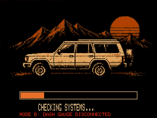
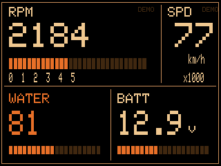
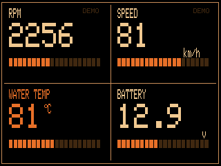

# hj60_coolant

Engine coolant temperature for a Toyota Land Cruiser HJ60 (2H, 12 V), read from the factory gauge sender, on a
FriedRust-style 3.5" TFT dashboard with a buzzer alarm.

> **Sender mode.** `senderMode` at the top of the sketch is **`SENDER_MODE_B` (direct)** by default, as the owner
> asked. In mode B the YG wire is **disconnected from the dash gauge**, so the dash gauge does not work and the TFT is
> the only coolant gauge. Set `SENDER_MODE_A` for the passive taps, which keep the dash gauge working.
> See [report section 8](docs/gauge-tap-report.md#8-other-connection-options-b-and-c).

| Check screen | Main | Grid |
|---|---|---|
|  |  |  |

Wokwi screenshots (ILI9341 320x240 stand-in, taken on the classic ESP32 before the move to the S3; the screens are the same). The real ILI9488 is 480x320. Design: [docs/img/design-mockup.png](docs/img/design-mockup.png).

| | |
|---|---|
| Board | ESP32-S3 DevKitC-1 N16R8 (`esp32:esp32:esp32s3`), [ADR 0012](../../docs/adr/0012-hj60-move-to-esp32-s3.md) (was DevKit V1, ADR 0007) |
| Emulator board | ESP32-S3 DevKitC-1 (`esp32:esp32:esp32s3`) |
| Serial | 115200 baud |
| Parts | ILI9488 3.5" SPI TFT, sender circuit for mode A or B on GPIO4/35 (+GPIO7 in B), battery divider (GPIO6), button (GPIO15), active buzzer via NPN (GPIO17). Pins: [docs/README.md](docs/README.md) |
| Power | USB (car USB adapter). ESP32 GND to the engine block. `batterySense = false` |
| Status | 40 native tests and the Wokwi mode B scenario pass. RPM and speed are DEMO values. Not on the truck yet: needs measurements M0–M6 ([report](docs/gauge-tap-report.md#6-plan)). **Don't trust WARN/ALARM until the M4 sender calibration** (two-point curve, ±10 °C near 100 °C) |
| Idea | [docs/ideas/2026-11-01-hj60-coolant.md](../../docs/ideas/2026-11-01-hj60-coolant.md) |

## Folders

| Path | What | Rule |
|---|---|---|
| `firmware/hj60_coolant/` | Uploadable sketch for the real board | Only changed via `make promote`, or by hand when the change cannot be simulated |
| `emulator/wokwi/hj60_coolant_sim/` | Sim copy, where changes are made and tested | Same code as firmware once promoted |
| `emulator/wokwi/diagram.json` | Wokwi circuit | Keep in step with `docs/README.md` wiring |
| `emulator/wokwi/shims/` | ILI9488 → ILI9341 shim ([ADR 0010](../../docs/adr/0010-hj60-ili9488-tft-and-sim-shim.md)) | Sim only |
| `emulator/wokwi/chips/` | Custom chip for the mode B sender circuit ([ADR 0011](../../docs/adr/0011-hj60-wokwi-sender-chip.md)) | Sim only |
| `tools/png_to_boot_art.py` | Converts the boot images to `boot_art.h` | |
| `emulator/wokwi/scenarios/` | Wokwi automation scenarios | One per behaviour |
| `emulator/native/` | Host tests (`test_*.cpp`) | Run against both copies |
| `docs/` | Wiring, BOM, architecture for this project | |

## Commands

```sh
make test     P=hj60_coolant     # host tests, no hardware
make sim      P=hj60_coolant     # Wokwi scenarios (needs WOKWI_CLI_TOKEN)
make promote  P=hj60_coolant     # sim copy -> firmware
make upload   P=hj60_coolant PORT=/dev/cu.usbserial-XXXX   # check senderMode first
```

## Docs

- [Wiring diagram for the ESP32-S3 (open in a browser)](docs/html/wiring-diagram.html), [PNG](docs/img/wiring-diagram.png)
- [Interactive circuit explainer (open in a browser)](docs/html/circuit-explainer.html): gauge, sender, regulator, ESP32 taps
- [Report: what the multimeter showed, what went wrong, the plan](docs/gauge-tap-report.md)
- [Plan: TFT dashboard and option B](docs/plan-tft-ui-and-option-b.md)
- [Hardware + wiring](docs/README.md)
- [Software architecture](docs/architecture.md)
