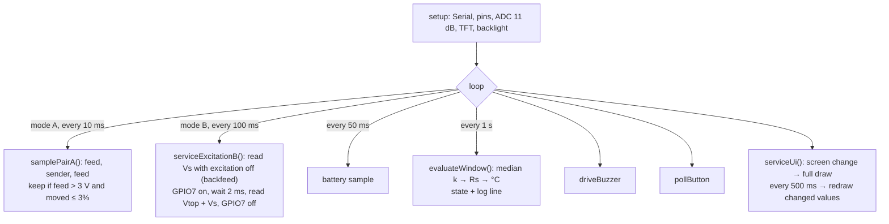

# hj60_coolant -- software architecture

## Loop

`senderMode` selects A or B. It is a global at the top of the sketch. Change it before you flash. The default is B.

## Reading → state

| Condition | State |
|---|---|
| No valid sample since boot (< 5 s) | `WAIT` |
| No valid sample for 5 s | `FAULT-NOFEED` (A) / `FAULT-NOEXCITE` (B) |
| B: wire > 0.6 V with excitation off, in ≥ half the samples of 1 s | `FAULT-BACKFEED` |
| k ≥ 0.998 (A) / k ≥ 0.97 (B: an open wire gives 0.988) | `FAULT-OPEN` |
| Rs < 5 Ω | `FAULT-SHORT` |
| ≥ 105 °C (stays until < 103 °C) | `ALARM`, buzzer steady |
| ≥ 100 °C (stays until < 98 °C) | `WARN`, buzzer toggles every 400 ms |
| otherwise | `OK`, silent |

Faults sound a double chirp every 5 s.

## Screens

| Screen | When | Content |
|---|---|---|
| BOOT | 0–1.5 s | FRIEDRUST title art |
| CHECK | 1.5–6 s | Truck art, progress bar, mode line, then sender and battery result |
| MAIN | default | RPM (DEMO) + bar, SPD (DEMO), WATER, BATT |
| GRID | button | RPM, SPEED, WATER TEMP, BATTERY |
| WATER | button, or automatic on WARN/ALARM | Big water temperature, RPM, SPEED, BATT |

- The button (GPIO15) selects MAIN → GRID → WATER → MAIN. It does nothing during BOOT and CHECK.
- On WARN or ALARM the WATER screen shows, with a red frame. ALARM flashes the frame. When the state goes back to OK,
  the screen that the driver chose comes back.
- A fault replaces the WATER label with its name: SENDER OPEN, SENDER SHORT, WIRE HAS VOLTAGE, NO GAUGE FEED,
  NO EXCITATION.
- The UI draws a screen once (full redraw), then only redraws a value when its text changes.
- The UI uses a 480x320 design grid. `X()`, `Y()` and `textSize()` scale it to the panel (480x320 real, 320x240 in
  Wokwi).
- Boot art: `boot_art.h`, 16 colours, 4 bits for each pixel, drawn one row at a time.

## Constants to set from truck measurements

| Constant | Default | Source / step |
|---|---|---|
| `senderMode` | `SENDER_MODE_B` | Owner choice. A keeps the dash gauge working. |
| `batterySense` | `false` | USB power: the BATT tile shows USB. `true` only with the GPIO6 divider wired. |
| `GAUGE_R_OHMS` | 25.0 | A: FSM 13-74, measure (M1) |
| `REF_R_OHMS` | 220.0 | B: Rref, 1% or better |
| `SENDER_R0/T0`, `SENDER_R1/T1` | 226 Ω @ 50 °C, 26 Ω @ 115 °C | FSM 13-74, calibrate (M4) |
| `ADC_OFFSET_MV` | 0 | M5 with 47 Ω and 100 Ω in place of the sender |
| `DIVIDER_RATIO` | 7.8 | A taps and battery: 68k/10k |
| `VTOP_RATIO`, `VS_RATIO` | 17.6/12 = 1.467 | B: 5.6k/12k |
| `VS_LOAD_OHMS` | 17600 | B: the Vs divider, removed from the sender reading |
| `FEED_ON_V` | 3.0 V | A: below the on-level from M2 |
| `SAMPLE_MS` / `MIN_PAIRS` | 10 ms / 5 | A: each 1 s window needs ≥ `MIN_PAIRS` on-samples |
| `BACKFEED_V` | 0.6 V | B: above the ADC offset, below a real backfeed |
| `WARN_C` / `ALARM_C` | 100 / 105 °C | Report section 5 |

## Serial protocol (115200)

| Line | Meaning |
|---|---|
| `hj60_coolant boot ok  Mode:B (direct, DASH GAUGE DISCONNECTED)` | setup() finished, with the mode |
| `Coolant: 92.4C  Rs:52.1ohm  k:0.676  Feed:11.7V  Batt:12.9V  Mode:A  State:OK` | Once per second, mode A |
| `Coolant: 92.4C  Rs:52.1ohm  k:0.343  Vtop:3.00V  Batt:12.9V  Mode:B  State:OK` | Once per second, mode B |
| `Coolant: --  Rs:--  k:--  Vtop:--  Batt:12.9V  Mode:B  State:FAULT-BACKFEED` | Missing values print `--` |

## Tests

| File | What |
|---|---|
| `emulator/native/truck_model.h` | Truck models: mode A (pulsed regulator) and mode B (switched excitation, backfeed) |
| `emulator/native/test_mode_a.cpp` | 18 tests: conversion, pulsing, bounce, thresholds, faults, log format |
| `emulator/native/test_mode_b.cpp` | 13 tests: conversion, excitation pulses, thresholds, faults, backfeed, battery |
| `emulator/native/test_ui.cpp` | 8 tests: boot sequence, mode line, button, alarm screen, fault label, redraws |
| `emulator/wokwi/scenarios/smoke.yaml` | Mode B: OK → ALARM → FAULT-OPEN → FAULT-BACKFEED |
