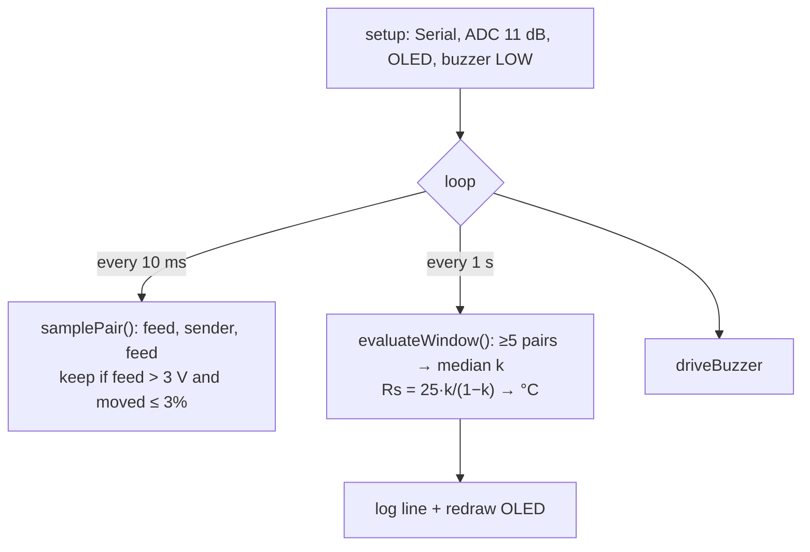

# hj60_coolant -- software architecture

## Loop

## Reading → state

| Condition | State |
|---|---|
| No valid pair since boot (< 5 s) | `WAIT` |
| No valid pair for 5 s | `FAULT-NOFEED` |
| k ≥ 0.998 | `FAULT-OPEN` |
| Rs < 5 Ω | `FAULT-SHORT` |
| ≥ 105 °C (stays until < 103 °C) | `ALARM`, buzzer steady |
| ≥ 100 °C (stays until < 98 °C) | `WARN`, buzzer toggles every 400 ms |
| otherwise | `OK`, silent |

Faults sound a double chirp every 5 s. A missing OLED is logged and ignored, so the buzzer still works.

Windows with fewer than 5 valid pairs (regulator off-phase) keep the last reading.

## Constants to set from truck measurements

| Constant | Default | Source / step |
|---|---|---|
| `GAUGE_R_OHMS` | 25.0 | FSM 13-74, measure (M1) |
| `SENDER_R0/T0`, `SENDER_R1/T1` | 226 Ω @ 50 °C, 26 Ω @ 115 °C | FSM 13-74, calibrate (M4) |
| `DIVIDER_RATIO` | 7.8 | 68k/10k; check with M5 |
| `FEED_ON_V` | 3.0 V | Set below the on-level from M2 |
| `SAMPLE_MS` / `MIN_PAIRS` | 10 ms / 5 | M2: each 1 s window needs ≥ `MIN_PAIRS` on-samples, or a false FAULT-NOFEED fires |
| `WARN_C` / `ALARM_C` | 100 / 105 °C | Report section 5 |

## Serial protocol (115200)

| Line | Meaning |
|---|---|
| `hj60_coolant boot ok` | setup() finished |
| `OLED not found, continuing without display` | display.begin() failed |
| `Coolant: 92.4C  Rs:52.1ohm  k:0.676  Feed:11.7V  State:OK` | Once per second |
| `Coolant: --  Rs:--  k:--  Feed:--  State:FAULT-NOFEED` | Missing values print `--` |
