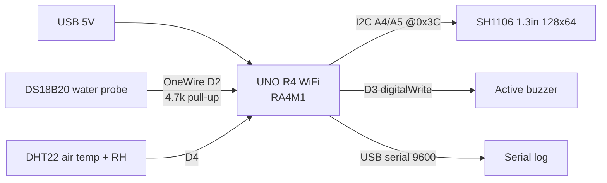
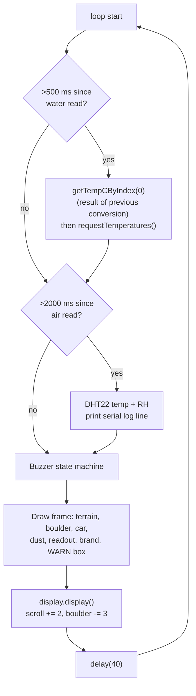
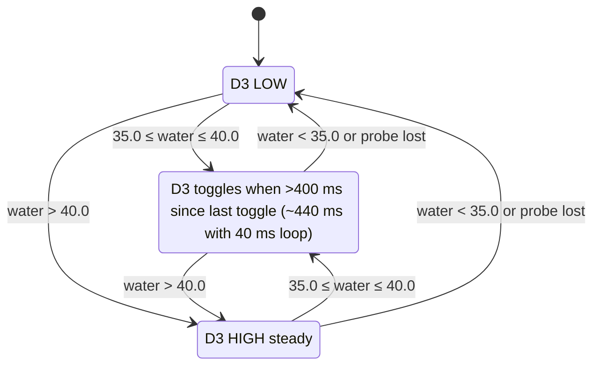

# water_monitor: how it runs

Hardware details (BOM, pin map, circuit, bring-up) are in [markdown/README.md](markdown/README.md). This page covers
what the firmware does at runtime.

## Hardware blocks



## Boot (`setup()`)

1. `Serial.begin(9600)`, 300 ms settle.
2. Buzzer pin LOW. DS18B20 `begin()` at 10-bit resolution (~188 ms conversion). `dht.begin()`.
3. `display.begin(0x3C)`. **If it fails, the sketch prints `SH1106 allocation failed` and halts** (`for(;;)`).
4. Splash screen: "LC78 OFFROAD / Built by FriedRust" for 1.5 s.
5. Start the first DS18B20 conversion (`requestTemperatures()`).

## Main loop (~25 fps, `delay(40)`)



The water reading lags one cycle (≤ 500 ms) because each read returns the conversion requested the previous time.
This keeps the loop non-blocking.

## Buzzer state machine (water temperature)



Probe disconnected (`DEVICE_DISCONNECTED_C`) means silent. **Missing probe = no alarm**, which is a design choice
to revisit if this guards anything critical.

## Screen

| Area | Content |
|---|---|
| top-left 62x30 | `W:24.5°` / `A:22.0°` / `H:48%`, or `--` when a sensor fails |
| top-right | `FriedRust` |
| centre (flashing every 4 frames) | `WARM` (beep) or `W HOT!` (alarm) box |
| bottom | scrolling sine terrain, boulder, LC78 that lifts over the boulder |

## Serial log (every ~2 s)

```
Water: 24.5C/76.1F   Air: 22.0C/71.6F  Hum:48%   Buzzer: OFF
Water: --   Air: --   Buzzer: OFF          (sensor failures)
```

`Buzzer:` is one of `OFF`, `BEEP`, `LOUD-CONT`. The native tests and the Wokwi scenario both assert on this format.
Changing it means updating both.

## Timing budget

| Task | Period | Blocking time |
|---|---|---|
| DS18B20 read + new conversion | 500 ms | ~few ms (OneWire) |
| DHT22 read + log | 2000 ms | ~5 ms |
| Frame draw + I2C push (1 KB) | every loop | ~25 ms at 400 kHz I2C |
| `delay(40)` | every loop | 40 ms |

## Sim vs real

| Real | Wokwi | Native |
|---|---|---|
| UNO R4 WiFi (RA4M1) | AVR Uno (ATmega328P) | host clang++ |
| SH1106 | SSD1306 via shim | text capture |
| DS18B20 / DHT22 | Wokwi parts | `sim::ds18b20C`, `sim::dhtTempC` |
| active buzzer | Wokwi buzzer on D3 | `sim::pinLevel[3]` |
