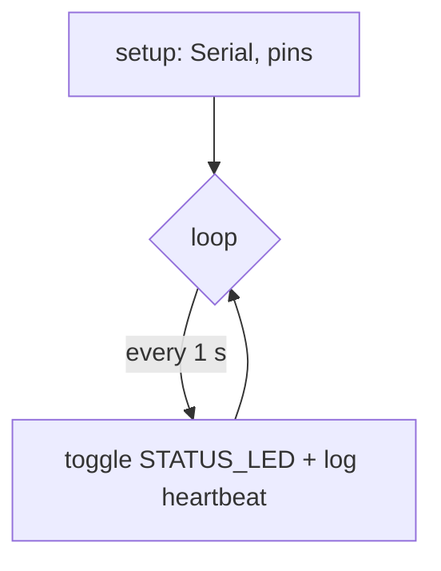

# __NAME__ -- software architecture

## Loop

## Timing

| Task | Period | Blocking? |
|---|---|---|
| heartbeat | 1000 ms | no (millis) |

## Serial protocol

| Line | Meaning |
|---|---|
| `__NAME__ boot ok` | setup() finished |
| `heartbeat <s>` | alive, uptime seconds |
